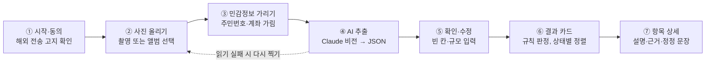
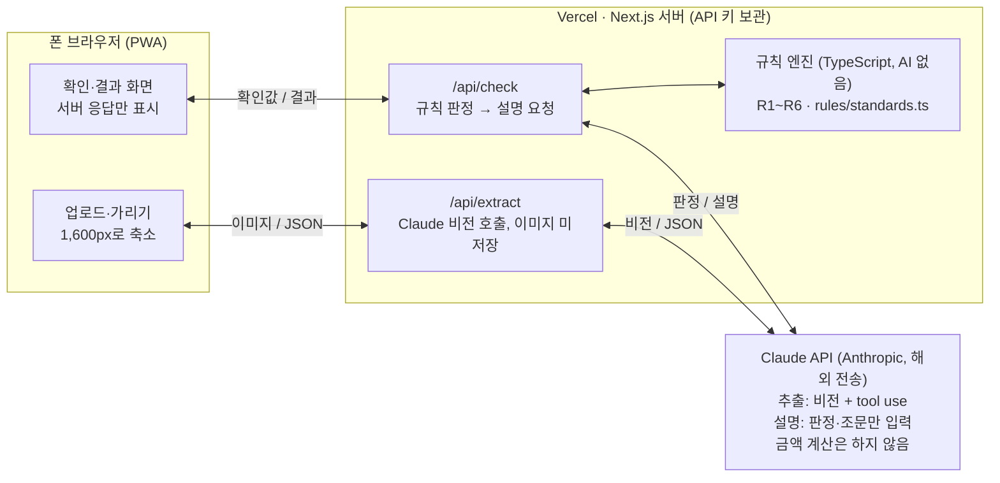
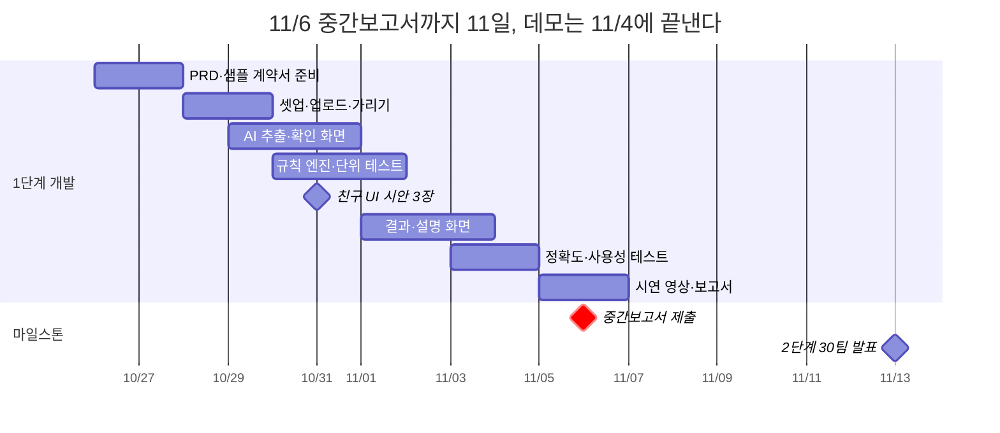

# 페이체크 PRD

2026-10-26 · v0.1 (1단계 착수용)

## 개요

페이체크는 알바 근로계약서와 급여명세서 사진을 올리면 확인이 필요한 조항과 덜 받은 금액을 근거와 함께 보여주는 모바일 웹이다. 이 문서는 **11/6 중간보고서까지 만들 1단계 MVP(근로계약서 점검)**를 중심으로 쓰고, 2단계(급여명세 대조)는 범위만 정한다.

| 항목 | 내용 |
| --- | --- |
| 대회 | AI:ON 2026 (명지전문대 앵커사업단), 1단계 선정 |
| 팀 / 멘토 분야 | 내돈내놔 · 2번 AI 기반 웹·앱 개발 |
| 개발 인원 | 1명(팀장, 컴공) + 디자인·사용성 테스트 1명(산디) |
| 형태 | 모바일 웹(PWA), Next.js + Claude API |
| 문서 버전 | v0.1 (1단계 착수용) |

## 배경과 문제

첫 알바를 하는 대학생은 계약서와 급여가 맞는지 스스로 판단하지 못해 손해를 보고도 모르고 넘어간다. 팀장 본인과 친구들이 스무 살 첫 알바 때 3.3% 공제와 주휴수당을 몰라 매번 검색하고 부모님께 물었고, 팀장이 친구들의 계약서를 대신 확인해준 경험이 출발점이다.

- **규정이 조건마다 다르다.** 주 15시간 이상인지, 5인 이상 사업장인지, 계약기간이 1년 이상인지에 따라 주휴수당·가산수당·수습 감액 적용이 달라진다.
- **기존 계산기는 입력을 사용자에게 떠넘긴다.** 시급과 시간을 직접 넣어야 하고, 계약서 자체의 문제(필수 기재사항 누락, 3.3% 프리랜서 처리)는 보지 않는다.
- **확신이 없으니 말을 못 꺼낸다.** 노무사 상담은 문턱이 높고, "내가 계산을 잘못한 건 아닐까" 하는 불안이 행동을 막는다.

**왜 지금:** 2027년 1월부터 최저시급이 10,700원으로 바뀌어 겨울방학 알바생이 새 기준으로 계약서를 확인해야 하고, AI가 사진 속 문서를 읽을 수 있게 되면서 학생 혼자서도 이 서비스를 만들 수 있게 됐다.

## 대상 사용자와 시나리오

핵심 사용자는 **사회 경험 없이 첫 알바를 시작하는 20대 초반 대학생**이고, 폰으로 계약서를 찍어 그 자리에서 확인하는 장면이 1순위다.

**페르소나: 김민지 (20세, 대학 1학년)**

- 동네 카페에서 주 3일, 하루 5시간 근무 예정. 첫 알바.
- 사장님이 계약서를 주며 "여기 사인하면 돼요"라고 함. 수습 3개월은 시급 90%라고 적혀 있음.
- 주휴수당이 뭔지 들어본 적은 있지만 본인이 해당되는지 모름.
- 원하는 것: 사인해도 되는지, 이상한 부분이 있으면 사장님께 뭐라고 말하면 되는지.

**핵심 시나리오**

1. **계약서 서명 전후 (1단계):** 계약서를 찍어 올리면 30초 안에 "확인이 필요한 항목 2개"와 이유, 근거 조문, 사장님께 보낼 문장을 받는다.
2. **첫 급여를 받은 뒤 (2단계):** 급여명세서나 입금 내역을 올려 계약 조건과 대조하고, 덜 받은 금액을 확인한다.
3. **친구 대신 확인 (부가):** 친구가 보낸 계약서 사진을 대신 올려 확인해준다. 팀장이 해오던 역할을 서비스가 대신한다.

## 목표와 성공 지표

1단계 목표는 **11/6까지 계약서 한 장으로 핵심 점검 5개가 끝까지 동작하는 데모와 시연 영상**을 만들어 2단계 30팀에 드는 것이다.

| 지표 | 목표 | 측정 방법 |
| --- | --- | --- |
| 필드 추출 정확도 | 테스트셋 기준 90% 이상 | 계약서 15장 이상, 필드별 정답과 비교 |
| 규칙 판정 정확도 | 100% | 경계 사례 단위 테스트 30개 이상 통과 |
| 업로드→결과 시간 | 30초 이내 | 실제 폰, LTE 환경 5회 평균 |
| 혼자 완료율 | 5명 중 4명 이상 | 친구 대상 사용성 테스트, 도움 없이 결과 화면까지 |
| 결과 이해도 | 5명 중 4명 이상 "무엇을 해야 할지 안다" | 테스트 직후 한 문장 질문 |

추출이 틀려도 사용자가 확인 화면에서 고칠 수 있으므로, 판정 정확도(100%)가 추출 정확도보다 우선이다.

## 범위

1단계는 **시급제 근로계약서 한 장**만 다룬다. 월급제, 급여명세서, 야간·연장수당은 2단계로 미룬다.

| 기능 | 1단계 (~11/6) | 2단계 (~12/11) |
| --- | --- | --- |
| 계약서 사진 업로드 + 민감정보 가리기 | P0 | 유지 |
| AI 항목 추출 → 확인·수정 | P0 | 유지 |
| 점검 5개: 최저임금, 주휴수당, 휴게시간, 수습 감액, 필수 기재사항 | P0 | 유지 |
| 3.3% 공제·프리랜서 계약 신호 | P1 (시간 남으면) | P0 |
| 근거 조문 + 쉬운 설명 | P0 | 유지 |
| 사장님께 보낼 정정 요청 문장 | P1 | P0 |
| 급여명세서 대조, 덜 받은 금액 계산 | — | P0 |
| 야간·연장·휴일 가산수당 (5인 이상) | — | P0 |
| 월급제 시급 환산 | — | P1 |
| 노동청 진정·상담 안내 | — | P1 |
| PWA 홈 화면 추가 | — | P1 |

**하지 않을 것:** 회원가입·로그인, 이미지 저장, 결과 이력 저장, 유료 기능, 노무 상담 연결, 네이티브 앱, 손글씨 계약서 인식 보장, 근로자 외 계약(위탁·도급)의 법적 판단.

## 사용자 흐름과 화면 구성

화면은 4개(시작, 업로드·가리기, 확인·수정, 결과)이고, 판정은 사용자가 추출값을 확인한 뒤에만 실행된다.



결과 화면에서 항목을 누르면 같은 화면 안에서 상세(설명, 근거 조문, 정정 요청 문장)가 펼쳐진다. 친구에게 부탁할 UI 시안은 ②, ⑤, ⑥ 세 화면이다.

## 기능 요구사항

모든 기능은 "AI는 읽고 설명만, 판정과 계산은 코드" 원칙을 따른다.

| ID | 기능 | 요구사항 | 완료 기준 |
| --- | --- | --- | --- |
| F1 | 사진 업로드 | 카메라 촬영 또는 앨범 선택, JPG·PNG·HEIC, 최대 2장(앞뒤면) | 폰 브라우저 2종(iOS Safari, Android Chrome)에서 동작 |
| F2 | 민감정보 가리기 | 업로드 전 화면에서 손가락으로 사각형을 그려 가림. 가린 영역은 브라우저에서 검게 칠한 뒤 전송 | 원본 이미지는 서버로 가지 않음 |
| F3 | 항목 추출 | Claude 비전으로 데이터 명세의 JSON 스키마대로 추출. 못 읽은 값은 null + 신뢰도 낮음 표시 | 테스트셋 필드 정확도 90% |
| F4 | 확인·수정 | 추출값을 폼으로 보여주고 수정 가능. null 항목과 사업장 규모(5인 이상/미만/모름)는 반드시 묻기 | 수정값이 판정에 그대로 반영 |
| F5 | 규칙 판정 | 점검 규칙 명세의 5개 항목을 TypeScript 순수 함수로 판정: 문제 있음 / 확인 필요 / 문제 없음 | 단위 테스트 전부 통과 |
| F6 | 결과 화면 | 상태별 카드, 항목마다 한 줄 요약 + 금액 차이(있으면) + 근거 조문 | 문제 있는 항목이 맨 위 |
| F7 | 쉬운 설명 | 판정 결과와 해당 조문만 Claude에 넘겨 2~3문장 설명 생성. 숫자는 코드가 계산한 값만 인용 | 설명에 새 숫자가 등장하지 않음(검사 코드로 확인) |
| F8 | 정정 요청 문장 (P1) | 문제 있는 항목으로 사장님께 보낼 정중한 메시지 초안 + 복사 버튼 | 존댓말, 3문장 이내 |
| F9 | 안내 문구 | 모든 결과 화면 하단에 "참고용 점검이며 법률 판단이 아님, 정확한 확인은 고용노동부 상담센터(1350)" | 항상 노출 |

## 점검 규칙 명세

규칙은 모두 코드로 구현하고, 조건이 하나라도 불명확하면 "문제 있음" 대신 **"확인 필요"**로 낮춰 판정한다. 아래 조문과 기준은 개발 전 고용노동부 자료로 한 번 더 대조한다.

| 항목 | 문제 있음 | 확인 필요 | 근거 |
| --- | --- | --- | --- |
| R1 최저임금 | 시급 < 해당 연도 최저시급 (2026년 10,320원) | 계약기간이 2027년에 걸치는데 인상 언급 없음 → 2027-01-01부터 10,700원 이상이어야 함 | 최저임금법 제6조 |
| R2 수습 감액 | 감액 있음 + 계약기간 1년 미만, 또는 감액 기간 3개월 초과, 또는 감액 후 최저시급 90% 미만 | 업무가 단순노무(주방보조, 배달, 청소 등)일 수 있음 → 이 경우 감액 불가 | 최저임금법 제5조 제2항, 시행령 제3조 |
| R3 주휴수당 | 주 소정근로시간 15시간 이상인데 주휴수당 "없음"으로 명시 | 15시간 이상인데 언급 없음, 또는 "시급에 포함"이라고만 적힘 | 근로기준법 제18조 제3항, 제55조 |
| R4 휴게시간 | 1일 근로 4시간 이상인데 휴게 30분 미만, 8시간 이상인데 1시간 미만 | 휴게시간 기재 없음 | 근로기준법 제54조 |
| R5 필수 기재사항 | — | 임금(구성·계산·지급방법), 소정근로시간, 근로일·근로일별 근로시간, 휴일, 근무 장소·업무, 계약기간 중 빠진 항목 나열 | 근로기준법 제17조, 기간제법 제17조 |
| R6 3.3% 신호 (P1) | — | "3.3%", "사업소득", "프리랜서", "업무위탁" 문구 + 정해진 근무시간·장소 → 근로자인데 프리랜서로 처리됐을 수 있음 | 근로기준법 제2조 (근로자성은 실질로 판단) |

**계산식 (R3):** 1주 주휴수당 = min(주 소정근로시간, 40) ÷ 40 × 8 × 시급

**검증 예시 (페르소나):** 주 3일 × 5시간 = 15시간, 시급 10,320원 → 주휴 대상, 주휴수당 15 ÷ 40 × 8 × 10,320 = **30,960원/주**. 수습 90% 감액이 있고 계약기간 6개월이면 R2 "문제 있음", 휴게 기재가 없으면 R4 "확인 필요".

## 데이터 명세

AI 추출 결과는 아래 JSON 하나로 고정하고, Claude API의 도구 호출(tool use) 입력 스키마로 강제한다. 모든 필드는 null 허용이며, 각 값에는 계약서 원문 구절(`evidence`)을 함께 받아 확인 화면에 보여준다.

```json
{
  "contract_period": { "start": "2026-11-01", "end": "2027-04-30", "indefinite": false },
  "workplace": "○○카페 △△점",
  "job_description": "음료 제조 및 매장 관리",
  "wage": { "type": "hourly", "amount": 10320, "includes_weekly_holiday_pay": null },
  "probation": { "exists": true, "months": 3, "wage_rate": 0.9 },
  "schedule": [ { "day": "월", "start": "10:00", "end": "15:00", "break_minutes": null } ],
  "weekly_holiday": { "mentioned": false, "day": null },
  "pay_method": { "payday": "매월 10일", "method": "계좌이체" },
  "deduction_notes": ["3.3%"],
  "evidence": { "wage.amount": "시급 10,320원" },
  "low_confidence_fields": ["schedule[0].break_minutes"]
}
```

**사용자 입력 (확인 화면에서만 받음):** 사업장 규모(5인 이상 / 미만 / 모름), 단순노무 여부(예 / 아니오 / 모름).

**기준값 파일 (`rules/standards.ts`):** 연도별 최저시급(2026: 10,320, 2027: 10,700), 주휴 기준 15시간, 휴게 기준(4h→30분, 8h→60분), 수습 감액률 0.9와 최대 3개월, 근거 조문 텍스트. 법이 바뀌면 이 파일만 고친다.

## 기술 구조

Next.js(App Router) 한 프로젝트를 Vercel에 배포하고, Claude API는 서버 API 라우트 두 곳에서만 호출한다.



규칙 엔진은 Claude와 연결되지 않은 순수 함수라 단위 테스트(Vitest)만으로 검증한다. 추출은 tool use 입력 스키마로 JSON 형식을 강제하고, 설명 단계에는 판정 결과와 해당 조문만 넘긴다.

| 영역 | 선택 |
| --- | --- |
| 프레임워크 | Next.js + TypeScript, Tailwind CSS |
| 배포 | Vercel (API 키는 환경변수) |
| AI | Claude API (비전 추출, 설명 생성) |
| 테스트 | Vitest (규칙 엔진), 테스트셋 정확도 스크립트 |
| 개발 도구 | Claude Code(기능 구현), Cursor(화면 수정·디버깅) |

## 비기능 요구사항

가장 큰 리스크는 개인정보와 법적 표현이므로, 둘은 1단계부터 지킨다.

- **개인정보:** 주민등록번호·계좌번호는 업로드 전에 브라우저에서 가린다(F2). 이미지는 서버 메모리에서만 처리하고 저장·로그 기록하지 않는다. 첫 화면에 "사진은 해외 AI 서비스(Anthropic)로 전송되어 분석 후 저장되지 않음"을 고지하고 동의 체크를 받는다.
- **법적 표현:** "위법", "진단", "판정" 대신 "확인이 필요해요", "기준과 달라요"를 쓴다. 무료·참고용임을 명시하고 상담 경로(고용노동부 1350)를 안내한다.
- **정확도:** 금액은 코드만 계산한다. AI 설명문에 코드 결과에 없는 숫자가 나오면 설명을 버리고 기본 문구로 대체한다.
- **보안:** Claude API 키는 서버 환경변수에만 두고, 모든 호출은 Next.js API 라우트에서 한다. 요청은 IP당 분당 5회로 제한한다.
- **비용:** 계약서 1건당 API 호출 2회(추출 1, 설명 1). 대회 기간 사용량은 몇 달러 수준으로 예상하고, Anthropic 콘솔에서 월 사용 한도를 걸어둔다.
- **성능·호환:** 업로드 전 이미지를 긴 변 1,600px로 줄여 전송량과 시간을 줄인다. iOS Safari, Android Chrome 최신 버전 지원.

## 일정과 마일스톤

중간보고서 마감(11/6)까지 11일이다. 동작하는 데모를 11/4까지 끝내고, 마지막 이틀은 시연 영상과 보고서에만 쓴다.



| 날짜 | 할 일 |
| --- | --- |
| 10/26–10/27 | PRD 확정, 샘플 계약서 10장 제작, 친구들에게 계약서 사진 요청 |
| 10/28–10/29 | 프로젝트 셋업, 업로드·가리기 화면 |
| 10/29–10/31 | AI 추출(/api/extract), 확인·수정 화면 |
| 10/30–11/1 | 규칙 엔진 R1~R5 + 단위 테스트 |
| 10/31 | 친구 UI 시안 3장 |
| 11/1–11/3 | 결과·설명 화면, UI 시안 반영 |
| 11/3–11/4 | 테스트셋 정확도 측정, 사용성 테스트 5명 |
| 11/5–11/6 | 시연 영상, 중간보고서 작성·제출 |

11/4까지 R1~R4가 동작하지 않으면 R5와 P1 기능을 빼고 영상부터 찍는다. 이후 일정은 11/13 2단계 발표, 12/11 최종보고서 마감, 12/18 본선 시연·시상식이다.

## 리스크와 미결정 사항

가장 시급한 리스크는 **테스트용 실제 계약서 확보**다. 이번 주 안에 요청하지 않으면 정확도 지표를 11/6까지 낼 수 없다.

| 리스크 | 영향 | 대응 |
| --- | --- | --- |
| 실제 계약서 부족 | 정확도 측정 불가, 실용성 점수 약화 | 표준근로계약서로 샘플 10장 직접 제작 + 친구 5명에게 가린 사진 요청 (10/27) |
| 손글씨·구겨진 사진 인식 실패 | 추출 오류 | 확인·수정 화면(F4)으로 보완, 촬영 가이드 문구 |
| 법 기준 해석 오류 | 신뢰도 하락 | "확인 필요" 우선 판정, 멘토링 때 노무 기준 검토 요청 |
| 혼자 개발 일정 지연 | 중간보고서 데모 미완성 | P1 기능은 과감히 2단계로, 11/4까지 동작 안 하면 R5를 제외 |
| 친구 참여 부족 | 협업 항목 감점 | UI 시안 3장(10/31), 사용성 테스트 5명(11/3)만 확실히 부탁 |

**정해야 할 것**

- [x] 팀명 확정: 내돈내놔
- [x] 2027년 최저시급 10,700원 공식 고시 확인
- [ ] 단순노무 업무 판별을 사용자 선택으로만 할지, 업무 내용으로 추정할지
- [ ] 앞뒤면 2장 이상 계약서 지원 여부
- [ ] 정정 요청 문장(F8)을 1단계 시연에 넣을지
