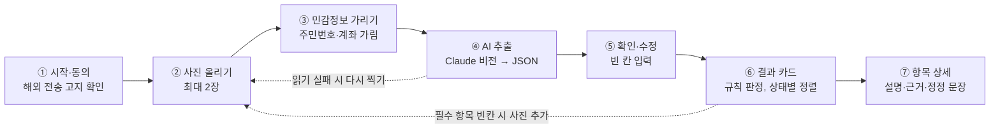
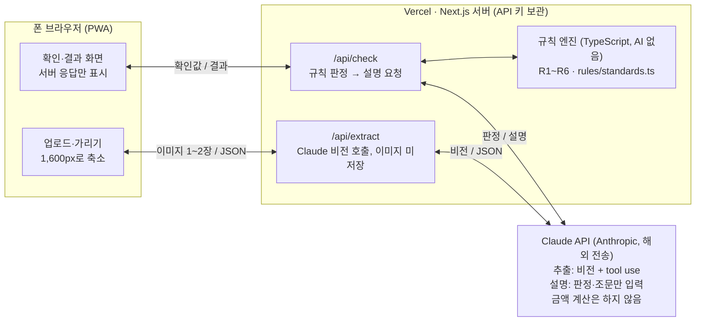
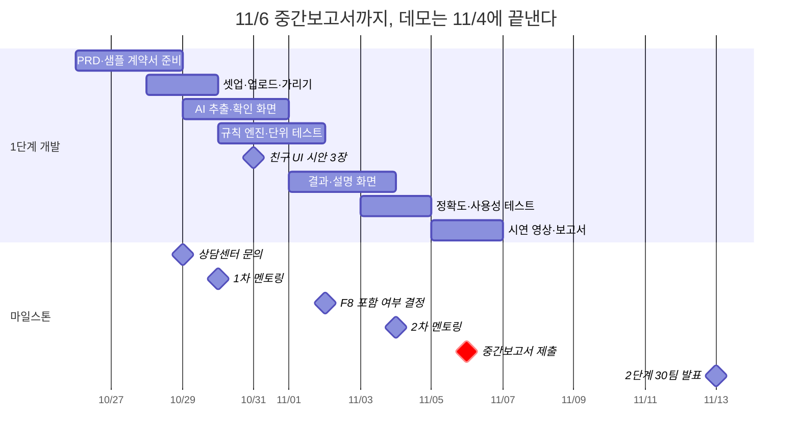

# 페이체크 PRD v1

AI:ON 2026 · 내돈내놔 팀 · v1 · 2026-10-28

> ✏️ 표시는 팀장이 직접 채울 부분이다.

## 1. 개요

페이체크는 알바 근로계약서와 급여 내역 사진을 올리면 확인이 필요한 조항과 덜 받은 금액을 근거와 함께 보여주는 모바일 웹이다. 이 문서는 11/6 중간보고서까지 만들 1단계 MVP(근로계약서 점검)를 중심으로 쓰고, 2단계(급여 대조)는 범위만 정한다.

| 항목 | 내용 |
| --- | --- |
| 대회 | AI:ON 2026 (명지전문대 앵커사업단), 1단계 선정 |
| 팀 / 멘토 분야 | 내돈내놔 · 2번 AI 기반 웹·앱 개발 |
| 개발 인원 | 1명(팀장, 컴공) + 디자인·사용성 테스트 1명(산디) |
| 형태 | 모바일 웹(PWA), Next.js + Claude API |

**변경 이력**

| 버전 | 날짜 | 내용 |
| --- | --- | --- |
| v0.1 | 10/26 | 초안 |
| v1 | 10/28 | 엣지 케이스·에러 처리, 주요 결정과 이유, 부록(상담센터 질문) 추가. 페르소나를 실제 사례로 교체. 섹션 통합(범위+기능, 데이터+기술 구조+비기능). 1단계에서 사업장 규모·단순노무 질문 제외. 사진 2장은 한 번에 전송. F8은 11/2 조건부 |

## 2. 배경과 문제

알바를 하면서 돈과 서류 문제를 혼자 알아보다가 막힌 경험이 출발점이다.

- 팀장은 학원 알바를 시작할 때 근로계약서와 함께 성범죄경력 조회 동의서를 썼다. 이게 법적으로 필수인 절차인지 몰라서 당황했다. 아버지가 그 근로계약서에 법적으로 문제가 있다며 직접 찾아보라고 해서 네이버로 관련 법령을 뒤져본 적도 있다.
- 설빙과 약국에서 일할 때는 매달 급여가 맞는지 헷갈렸고, 특히 주휴수당 계산이 어려웠다. 하우머치 앱에 근무 시간을 기록하면 매주 일요일에 주휴수당이 자동으로 적혔는데, 그게 뭔지도 모르고 앱 계산을 믿고 급여명세서와 비교했다.
- 친구들은 배스킨라빈스와 베이비시터 알바를 시작하면서 계약서는 제대로 보지 않았다. 대신 "사장님이 보건증 내라는데 어디서 어떻게 받냐"를 물었고, 월급이 들어온 계좌이체 화면을 보여주면 같이 계산기로 시급을 거꾸로 계산해봤다.

여기서 알게 된 것:

- **기존 앱은 계산은 해주지만 이해시켜주지 않는다.** 하우머치 같은 알바 급여 앱은 근무 기록과 수당 계산을 해주지만, 근무 시간과 시급을 사용자가 직접 입력해야 하고 "왜 이 금액인지", "내 계약서가 맞는지"는 알려주지 않는다. 결국 앱을 그냥 믿게 된다.
- **계약서를 안 보거나 못 받는 경우가 많다.** 확인은 계약서가 아니라 입금된 금액으로 한다.
- **규정이 조건마다 다르다.** 주 15시간 이상인지, 5인 이상 사업장인지, 계약기간이 1년 이상인지에 따라 주휴수당·가산수당·수습 감액 적용이 달라진다.
- **돈 말고 입사 서류도 헷갈린다.** 보건증, 성범죄경력 조회처럼 업종마다 다른 서류가 필요하다.

**왜 지금:** 2027년 1월부터 최저시급이 10,700원으로 바뀌어 겨울방학 알바생이 새 기준으로 계약서를 확인해야 하고, AI가 사진 속 문서를 읽을 수 있게 되면서 학생 혼자서도 이 서비스를 만들 수 있게 됐다.

## 3. 대상 사용자와 시나리오

핵심 사용자는 첫 알바를 시작하는 20대 초반 대학생이다. 실제 사례에서 두 유형이 보였다.

**유형 A: 계약서는 썼지만 무슨 뜻인지 모르는 사람 (팀장 본인)**

- 학원·카페·약국처럼 계약서를 쓰는 곳에서 일함.
- 수습, 주휴수당, 동의서 같은 단어가 나오면 필수인지 아닌지 판단을 못 함.
- 급여 앱을 쓰지만 계산 근거는 모름.
- 원하는 것: 사인하기 전에 이상한 데가 없는지, 있다면 뭐라고 말하면 되는지.

**유형 B: 계약서 없이 입금액만 보는 사람 (친구들)**

- 프랜차이즈 매장, 개인 간 계약(베이비시터)처럼 계약서를 대충 쓰거나 안 씀.
- 돈이 맞는지는 계좌이체 화면을 보고 계산기로 역산해서 확인.
- 원하는 것: 내가 받은 돈이 맞는지 빨리 알기.

1단계는 유형 A를, 2단계(입금 화면·명세서 대조)는 유형 B를 주로 돕는다.

**핵심 시나리오**

1. 계약서 서명 전후 (1단계): 계약서를 찍어 올리면 30초 안에 확인이 필요한 항목과 이유, 근거 조문, 사장님께 보낼 문장을 받는다.
2. 첫 급여를 받은 뒤 (2단계): 급여명세서나 계좌 입금 화면을 올려 계약 조건과 대조하고, 덜 받은 금액을 확인한다.
3. 계약서를 못 받았을 때 (1단계 안내): 계약서를 서면으로 받아야 한다는 것과 요청하는 방법을 안내받는다.

## 4. 목표와 성공 지표

1단계 목표는 11/6까지 계약서 한 장으로 핵심 점검 5개가 끝까지 동작하는 데모와 시연 영상을 만들어 2단계 30팀에 드는 것이다.

| 지표 | 목표 | 측정 방법 |
| --- | --- | --- |
| 필드 추출 정확도 | 테스트셋 기준 90% 이상 | 실제 계약서 5장 + 샘플 10장, 필드별 정답과 비교 |
| 규칙 판정 정확도 | 100% | 경계 사례 단위 테스트 30개 이상 통과 |
| 업로드→결과 시간 | 30초 이내 | 실제 폰, LTE 환경 5회 평균 |
| 혼자 완료율 | 5명 중 4명 이상 | 친구 대상 사용성 테스트, 도움 없이 결과 화면까지 |
| 결과 이해도 | 5명 중 4명 이상 "무엇을 해야 할지 안다" | 테스트 직후 한 문장 질문 |

추출이 틀려도 사용자가 확인 화면에서 고칠 수 있으므로, 판정 정확도(100%)가 추출 정확도보다 우선이다.

> ✏️ 사용성 테스트 인원과 테. 받으면 위 숫자(5명, 15장)를 맞춘다. 30초를 고른 이유도 한 줄.

## 5. 기능과 범위

1단계는 시급제 근로계약서(사진 최대 2장)만 다룬다. 화면은 4개(시작, 업로드·가리기, 확인·수정, 결과)이고, 판정은 사용자가 추출값을 확인한 뒤에만 실행된다.



결과 화면에서 항목을 누르면 같은 화면 안에서 상세(설명, 근거 조문, 정정 요청 문장)가 펼쳐진다. 친구에게 부탁할 UI 시안은 ②, ⑤, ⑥ 세 화면이다.

모든 기능은 "AI는 읽고 설명만, 판정과 계산은 코드" 원칙을 따른다.

| ID | 기능 | 우선순위 | 요구사항 | 완료 기준 |
| --- | --- | --- | --- | --- |
| F1 | 사진 업로드 | P0 | 카메라 촬영 또는 앨범 선택, JPG·PNG·HEIC, 최대 2장. 2장이면 한 요청에 같이 보내 JSON 하나로 받음(합치는 코드 없음) | iOS Safari, Android Chrome에서 동작 |
| F2 | 민감정보 가리기 | P0 | 업로드 전 손가락으로 사각형을 그려 가림. 가린 영역은 브라우저에서 검게 칠한 뒤 전송 | 원본 이미지는 서버로 가지 않음 |
| F3 | 항목 추출 | P0 | Claude 비전으로 데이터 명세의 JSON 스키마대로 추출. 못 읽은 값은 null + 신뢰도 낮음 표시 | 테스트셋 필드 정확도 90% |
| F4 | 확인·수정 | P0 | 추출값을 폼으로 보여주고 수정 가능. null 항목은 반드시 묻고, 시급은 값이 있어도 항상 확인받음 | 수정값이 판정에 그대로 반영 |
| F5 | 규칙 판정 | P0 | 점검 규칙 R1~R5를 TypeScript 순수 함수로 판정: 문제 있음 / 확인 필요 / 문제 없음 | 단위 테스트 전부 통과 |
| F6 | 결과 화면 | P0 | 상태별 카드, 항목마다 한 줄 요약 + 금액 차이(있으면) + 근거 조문. R5에서 빠진 항목이 있으면 "다른 장에 있나요? 사진 추가" 버튼 | 문제 있는 항목이 맨 위 |
| F7 | 쉬운 설명 | P0 | 판정 결과와 해당 조문만 Claude에 넘겨 2~3문장 설명 생성. 숫자는 코드가 계산한 값만 인용 | 설명에 새 숫자가 나오지 않음(검사 코드로 확인) |
| F8 | 정정 요청 문장 | 조건부 | 문제 있는 항목으로 사장님께 보낼 정중한 메시지 초안 + 복사 버튼. 11/2까지 R1~R4가 동작하면 1단계에 넣음 | 존댓말, 3문장 이내 |
| F9 | 안내 문구 | P0 | 모든 결과 화면 하단에 "참고용 점검이며 법률 판단이 아님, 정확한 확인은 고용노동부 상담센터(1350)" | 항상 노출 |
| F10 | 계약서를 못 받았어요 | P1 | 시작 화면 링크. 계약서는 서면으로 받아야 한다는 안내와 요청 문장 (AI 없이 고정 문구) | 근거 조문 포함 |
| F11 | 3.3% 신호 (R6) | P1 | 프리랜서 처리 의심 문구 감지 | 시간 남으면 1단계, 아니면 2단계 |

**2단계로 미룬 것:** 급여명세서·계좌 입금 화면 대조와 덜 받은 금액 계산(유형 B), 야간·연장·휴일 가산수당(5인 이상, 이때 사업장 규모 질문 추가), 월급제 시급 환산, 노동청 진정·상담 안내, PWA 홈 화면 추가, 앱스토어 배포 검토. F8과 F11은 2단계에서 P0로 올린다.

**2단계 후보:** 업종별 입사 서류 안내(보건증, 성범죄경력 조회 등). 실제 사례에서 나온 질문이고 AI 없이 정리된 정보로 만들 수 있다.

**하지 않을 것:** 회원가입·로그인, 이미지 저장, 결과 이력 저장, 유료 기능, 노무 상담 연결, 3장 이상 계약서, 손글씨 계약서 인식 보장, 근로자 외 계약(위탁·도급)의 법적 판단.

## 6. 점검 규칙 명세

규칙은 모두 코드로 구현하고, 조건이 하나라도 불명확하면 "문제 있음" 대신 "확인 필요"로 낮춰 판정한다. 해석이 애매한 부분은 부록 A의 질문으로 고용노동부 상담센터에 확인한다.

| 항목 | 문제 있음 | 확인 필요 | 근거 |
| --- | --- | --- | --- |
| R1 최저임금 | 시급 < 해당 연도 최저시급 (2026년 10,320원) | 계약기간이 2027년에 걸치는데 인상 언급 없음 → 2027-01-01부터 10,700원 이상이어야 함 | 최저임금법 제6조 |
| R2 수습 감액 | 감액 있음 + 계약기간 1년 미만, 또는 감액 기간 3개월 초과, 또는 감액 후 최저시급 90% 미만 | 위 조건은 통과했지만 감액이 있음 → 단순노무 여부는 묻지 않고 "주방 보조, 배달, 청소 같은 단순노무 업무라면 수습이어도 감액할 수 없어요" 안내 | 최저임금법 제5조 제2항, 시행령 제3조 |
| R3 주휴수당 | 주 소정근로시간 15시간 이상인데 주휴수당 "없음"으로 명시 | 15시간 이상인데 언급 없음, 또는 "시급에 포함"이라고만 적힘 | 근로기준법 제18조 제3항, 제55조 |
| R4 휴게시간 | 1일 근로 4시간 이상인데 휴게 30분 미만, 8시간 이상인데 1시간 미만 | 휴게시간 기재 없음 | 근로기준법 제54조 |
| R5 필수 기재사항 | — | 아래 목록 중 빠진 항목 나열 + 사진 추가 버튼 | 근로기준법 제17조, 기간제법 제17조 |
| R6 3.3% 신호 (P1) | — | "3.3%", "사업소득", "프리랜서", "업무위탁" 문구 + 정해진 근무시간·장소 → 근로자인데 프리랜서로 처리됐을 수 있음 | 근로기준법 제2조 (근로자성은 실질로 판단) |

**R5 필수 기재사항 목록 (사진 1~2장 안에 있어야 하는 것)**

| 묶음 | 항목 |
| --- | --- |
| 계약기간 | 근로계약기간 |
| 급여 | 임금의 구성항목, 계산방법, 지급방법 |
| 근로조건 | 소정근로시간, 근로일과 근로일별 근로시간, 휴게시간, 근무 장소와 업무 |
| 휴일·휴가 | 휴일(주휴일), 연차유급휴가 (5인 미만 사업장은 안 적어도 됨, 부록 A-8. 규모를 묻지 않으므로 빠진 항목으로 세지 않고 안내만) |

R1~R5는 모두 5인 미만 사업장에도 적용되므로, 1단계에서는 사업장 규모를 묻지 않는다.

**계산식**

- 1일 근로시간 = 종료 시각 − 시작 시각 − 휴게시간
- 주 소정근로시간 = 근무일별 1일 근로시간의 합
- 1주 주휴수당 = min(주 소정근로시간, 40) ÷ 40 × 8 × 시급

**검증 예시:** 카페 주 3일 × 5시간 = 15시간, 시급 10,320원 → 주휴 대상, 주휴수당 15 ÷ 40 × 8 × 10,320 = 30,960원/주. 수습 90% 감액이 있고 계약기간 6개월이면 R2 "문제 있음", 계약기간 1년이면 R2 "확인 필요"(단순노무 안내), 휴게 기재가 없으면 R4 "확인 필요".

## 7. 엣지 케이스와 에러 처리

정상 흐름에서 벗어나는 상황과 그때 보여줄 문구다. 어떤 경우에도 사용자가 입력한 값과 가린 사진은 화면에 유지해서 처음부터 다시 하지 않게 한다.

**사진과 추출**

| 상황 | 판단 기준 | 처리 | 화면 문구 |
| --- | --- | --- | --- |
| 계약서가 아닌 사진 | 추출 결과의 `is_contract`가 false | 확인 화면으로 넘어가지 않음, 다시 찍기 | "근로계약서가 아닌 것 같아요. 계약서 전체가 나오게 다시 찍어주세요." |
| 흐릿하거나 잘린 사진 | `low_confidence_fields` 3개 이상 | 확인 화면으로 가되 해당 칸을 노란색으로 표시 | "잘 안 보이는 항목이 있어요. 노란 칸을 직접 확인해 주세요." |
| 시급 오인식 가능성 | 항상 (손글씨, 10,320 ↔ 10.320 등) | 시급은 값이 있어도 사용자 확인 체크 필수 | "시급이 계약서와 같은지 확인해 주세요." |
| 파일을 열 수 없음 | HEIC 변환 실패, 손상된 파일 | 업로드 화면에 머묾 | "사진을 열 수 없어요. 다른 사진으로 다시 올려주세요." |
| 필수 항목이 빈칸 | R5에서 빠진 항목 있음 | 결과에 표시 + 사진 추가 버튼(최대 2장까지), 추가하면 2장을 다시 한 번에 추출 | "계약서에 OO이 안 보여요. 다른 장에 있다면 사진을 추가해 주세요." |

**계약 내용**

| 상황 | 처리 | 결과·문구 |
| --- | --- | --- |
| 근무 시간이 주마다 다름 ("주 2~4일, 스케줄 근무") | 확인 화면에서 "평소 일주일에 몇 시간 일하나요?" 직접 입력 | 입력이 없으면 R3 "확인 필요": "근무 시간이 정해져 있지 않아 주휴수당 대상인지 판단하기 어려워요." |
| 시급이 아닌 일급·월급 계약 | 1단계 범위 밖. 임금과 무관한 R4, R5만 판정 | "지금은 시급 계약서만 금액을 점검할 수 있어요. 휴게시간과 필수 기재사항은 확인했어요." |
| 휴게시간 기재 없음 | 1일 근로시간을 휴게 없이 계산, R4 "확인 필요" | "휴게시간이 적혀 있지 않아요. 실제로 쉬는 시간이 있는지 확인해 보세요." |
| 계약기간 정함 없음 | R2에서 "1년 이상"으로 처리 (부록 A-1: 3개월 10% 감액 가능 확인) | 감액 기간·비율만 판정 |
| 계약서를 아직 못 받음 | 업로드 대신 F10 안내 화면 | "근로계약서는 서면으로 받아야 해요. 이렇게 요청해 보세요." |

**경계값 (단위 테스트로 고정)**

| 입력 | 기대 판정 |
| --- | --- |
| 주 15시간 정확히 | R3 주휴 대상 |
| 주 14.5시간 | R3 주휴 비대상 (문제 없음) |
| 하루 4시간 정확히, 휴게 0분 | R4 문제 있음 (30분 필요) |
| 하루 3시간 59분, 휴게 0분 | R4 문제 없음 |
| 하루 8시간 정확히, 휴게 30분 | R4 문제 있음 (1시간 필요) |
| 계약기간 정확히 1년, 수습 3개월 90% | R2 확인 필요 (단순노무 안내) |
| 계약기간 364일, 수습 90% | R2 문제 있음 |
| 수습 없음 | R2 문제 없음 |
| 시급 10,320원, 2026-12-31 종료 | R1 문제 없음 |
| 시급 10,320원, 2027-01-01 이후까지 | R1 확인 필요 |

**시스템 오류**

| 상황 | 처리 | 화면 문구 |
| --- | --- | --- |
| Claude API 실패·30초 초과 | 1회 자동 재시도, 다시 실패하면 중단 | "분석이 늦어지고 있어요. 잠시 후 다시 눌러주세요." |
| 요청 제한 초과 (IP당 분당 5회) | 요청 거부 | "잠시 후 다시 시도해 주세요." |
| 설명문 검사 실패 (새 숫자 등장) | AI 설명을 버리고 규칙별 기본 문구 사용 | 사용자에게는 기본 문구만 보임 |
| 네트워크 끊김 | 입력값 유지, 재시도 버튼 | "인터넷 연결을 확인해 주세요." |

## 8. 기술 구조와 데이터

Next.js(App Router) 한 프로젝트를 Vercel에 배포하고, Claude API는 서버 API 라우트 두 곳에서만 호출한다.



| 영역 | 선택 |
| --- | --- |
| 프레임워크 | Next.js + TypeScript, Tailwind CSS |
| 배포 | Vercel (API 키는 환경변수) |
| AI | Claude API (비전 추출, 설명 생성) |
| 테스트 | Vitest (규칙 엔진), 테스트셋 정확도 스크립트 |
| 개발 도구 | Claude Code(기능 구현), Cursor(화면 수정·디버깅) |

**추출 데이터.** 사진이 1장이든 2장이든 한 요청에 담아 보내고, 결과는 아래 JSON 하나로 고정한다. tool use 입력 스키마로 형식을 강제하며, 모든 필드는 null 허용이다. 값마다 계약서 원문 구절(`evidence`)을 함께 받아 확인 화면에 보여준다.

```json
{
  "is_contract": true,
  "contract_period": { "start": "2026-11-01", "end": "2027-04-30", "indefinite": false },
  "workplace": "○○카페 △△점",
  "job_description": "음료 제조 및 매장 관리",
  "wage": { "type": "hourly", "amount": 10320, "includes_weekly_holiday_pay": null },
  "wage_components": "기본급, 주휴수당",
  "probation": { "exists": true, "months": 3, "wage_rate": 0.9 },
  "schedule": [ { "day": "월", "start": "10:00", "end": "15:00", "break_minutes": null } ],
  "schedule_fixed": true,
  "weekly_holiday": { "mentioned": false, "day": null },
  "annual_leave_mentioned": false,
  "pay_method": { "payday": "매월 10일", "method": "계좌이체" },
  "deduction_notes": ["3.3%"],
  "evidence": { "wage.amount": "시급 10,320원" },
  "low_confidence_fields": ["schedule[0].break_minutes"]
}
```

사용자에게 따로 받는 값은 스케줄이 고정되지 않은 경우의 평소 주 근로시간뿐이다.

**기준값 파일 (`rules/standards.ts`).** 연도별 최저시급(2026: 10,320, 2027: 10,700), 주휴 기준 15시간, 휴게 기준(4h→30분, 8h→60분), 수습 감액률 0.9와 최대 3개월, R5 필수 항목 목록, 근거 조문 텍스트. 법이 바뀌면 이 파일만 고친다.

**제약과 원칙**

- 개인정보: 주민등록번호·계좌번호는 업로드 전에 브라우저에서 가린다(F2). 이미지는 서버 메모리에서만 처리하고 저장·로그 기록하지 않는다. 첫 화면에서 "사진은 해외 AI 서비스(Anthropic)로 전송되어 분석 후 저장되지 않음"을 알리고 동의를 받는다.
- 법적 표현: "위법", "진단", "판정" 대신 "확인이 필요해요", "기준과 달라요"를 쓴다. 무료·참고용임을 밝히고 고용노동부 상담센터(1350)를 안내한다.
- 보안: API 키는 서버 환경변수에만 둔다. 요청은 IP당 분당 5회로 제한한다. 한 사람이 계약서 한 장을 확인하는 데 1~2회면 충분해서, 그 이상은 반복 호출로 본다.
- 비용: 계약서 1건당 API 호출 2회(추출 1, 설명 1). Anthropic 콘솔에서 월 사용 한도를 걸어둔다.
- 성능: 업로드 전 이미지를 긴 변 1,600px로 줄인다. 계약서 글자를 읽기에 충분하면서 전송 시간을 줄이는 크기이며, 테스트셋에서 정확도가 떨어지면 키운다.

## 9. 주요 결정과 이유

| 결정 | 검토한 다른 선택지 | 이유 |
| --- | --- | --- |
| 알바 계약서라는 주제 | 캠퍼스 도우미 등 | 캠퍼스 도우미는 직접 해봤는데 수요 없는 공급이었다. 에브리타임이 이미 잘 돼 있어서 니즈가 별로 없고, 장벽이 너무 낮아 아무나 다 하는 흔한 아이디어라 뺐다. |
| 앱이 아니라 모바일 웹(PWA) | 네이티브 앱 | 앱스토어 심사 기간이 가장 큰 걸림돌이다. 웹은 심사·설치 없이 링크 하나로 바로 쓰고, 코드 하나로 iOS와 Android를 지원하며, 고치면 바로 반영된다. PWA로 만들면 홈 화면 추가와 카메라 촬영도 된다. 2단계에서 가능하면 앱 배포를 검토한다. |
| 파인튜닝·OCR 없이 Claude 비전 하나로 추출 | OCR + 후처리 코드, 자체 모델 학습 | 파인튜닝은 학습용 계약서가 수백 장 필요한데 지금은 15장 수준이고 일정도 9일뿐이다. OCR은 글자만 읽어서 "어느 숫자가 시급인지" 정리하는 코드를 따로 짜야 하고, 계약서 양식이 제각각이라 쉽게 깨진다. Claude 비전은 읽기와 항목 정리(JSON)를 한 번에 해서 따로 학습 없이 바로 쓸 수 있다. |
| 급여 대조보다 계약서부터 | 급여명세 대조를 1단계로 | 계약서는 서명 전에 확인하면 손해를 미리 막을 수 있지만, 급여명세는 이미 손해를 본 뒤에 확인하게 된다. 급여가 맞는지 대조하려면 계약 조건이 기준이 되니까 계약서 읽기가 먼저 있어야 한다. |
| 판정과 계산은 AI가 아니라 코드로 | AI가 직접 판단·계산 | 하우머치를 믿고 비교했던 것처럼, 사용자는 결과를 그대로 믿는다. 그래서 금액이 틀리면 안 되고, 같은 계약서에 매번 같은 답이 나와야 한다. 규칙을 코드로 두면 테스트로 검증할 수 있다. |
| 사진 2장은 한 요청에 같이 보냄 | 장별로 따로 추출해서 합치기 | 합치는 로직을 따로 짤 필요가 없고, 1장일 때와 코드가 거의 같다. |
| 단순노무 여부는 묻지 않음 | 사용자에게 질문, AI가 업무 내용으로 추정 | 사용자도 대부분 모르고, AI 추정은 틀리면 잘못된 안내가 된다. 수습 감액이 있으면 "확인 필요"로 두고 기준만 설명한다. |

## 10. 일정과 마일스톤

중간보고서 마감(11/6)까지 동작하는 데모를 11/4에 끝내고, 마지막 이틀은 시연 영상과 보고서에만 쓴다.



| 날짜 | 할 일 |
| --- | --- |
| 10/26–10/28 | PRD v1 확정, 샘플 계약서 10장 제작, 실제 계약서 5장·임금명세서 2장 확보 |
| 10/28–10/29 | 프로젝트 셋업, 업로드·가리기 화면 |
| 10/29 | 고용노동부 상담센터(1350) 전화 문의 (부록 A) |
| 10/29–10/31 | AI 추출(/api/extract), 확인·수정 화면 |
| 10/30–11/1 | 규칙 엔진 R1~R5 + 경계값 단위 테스트 |
| 10/28–10/30 | 1차 멘토링 (기획·기술 구조 검토, 날짜 확정 전) |
| 10/31 | 친구 UI 시안 3장 |
| 11/1–11/3 | 결과·설명 화면, UI 시안 반영, 에러 처리 |
| 11/2 | R1~R4 동작하면 F8 추가 |
| 11/3–11/4 | 테스트셋 정확도 측정, 사용성 테스트, 2차 멘토링 |
| 11/5–11/6 | 시연 영상, 중간보고서 작성·제출 |

11/4까지 R1~R4가 동작하지 않으면 R5와 P1 기능을 빼고 영상부터 찍는다. 이후 일정은 11/13 2단계 발표, 12/11 최종보고서 마감, 12/18 본선 시연·시상식이다.

## 11. 리스크와 미결정 사항

실제 계약서 5장을 확보했고, 샘플 10장을 직접 만들어 테스트셋 15장을 채운다.

| 리스크 | 영향 | 대응 |
| --- | --- | --- |
| 실제 계약서 부족 | 정확도 측정 불가, 실용성 점수 약화 | 실제 5장 확보 완료, 표준근로계약서로 샘플 10장 제작(경계값 사례 포함) |
| 손글씨·구겨진 사진 인식 실패 | 추출 오류 | 확인·수정 화면(F4)과 노란 칸 표시로 보완, 촬영 안내 문구 |
| 법 기준 해석 오류 | 신뢰도 하락 | "확인 필요" 우선 판정, 상담센터 확인(부록 A), 답변 날짜 기록 |
| 혼자 개발 일정 지연 | 중간보고서 데모 미완성 | P1 기능은 2단계로, 11/4까지 안 되면 R5 제외 |
| 친구 참여 부족 | 협업 항목 감점 | UI 시안 3장(10/31), 사용성 테스트(11/3)만 확실히 부탁 |
| 서버 함수 실행 시간 제한 | 추출이 길어지면 요청이 끊김 | 배포 플랜의 함수 시간 제한 확인, 이미지 축소로 처리 시간 단축 |

**결정한 것**

- [x] 팀명: 내돈내놔
- [x] 2027년 최저시급 10,700원 공식 고시 확인
- [x] 사업장 규모 질문 → 1단계에서는 묻지 않음 (R1~R5는 규모와 무관)
- [x] 단순노무 판별 → 묻지도 추정하지도 않고, 수습 감액이 있으면 "확인 필요" + 기준 안내
- [x] 계약서 사진 → 최대 2장, 한 요청에 같이 보냄. 빠진 필수 항목은 R5로 표시하고 사진 추가 버튼
- [x] F8 정정 요청 문장 → 11/2까지 R1~R4가 동작하면 1단계에 넣음

**남은 것**

- [x] 계약기간 정함 없는 계약의 수습 감액 허용 여부 → 가능 (11/3 1350)
- [x] 5인 미만 사업장 계약서의 연차유급휴가 기재 필요 여부 → 안 적어도 됨 (11/3 1350)
- [x] 사용성 테스트 인원 1명
- [x] 테스트용 계약서: 실제 5장 + 샘플 10장


## 부록 A. 고용노동부 상담센터(1350) 문의 목록

평일 업무시간에 전화로 먼저 묻고, 답변은 통화 날짜와 함께 아래 "답변" 칸에 적는다. 상담 답변은 일반 안내라서, 판정 기준을 바꾸는 중요한 답은 국민신문고 서면 질의로 한 번 더 확인한다. 막연하게 묻지 말고 실제 알바 업무를 예로 들어 묻는다.

**수습 감액 (R2)**

| # | 질문 | 답변 |
| --- | --- | --- |
| A-1 | 계약기간을 정하지 않은 계약도 수습 기간에 최저임금 90% 감액이 가능한가요? | 가능. 수습 3개월까지 10% 감액 가능 (11/3 1350) |
| A-2 | 단순노무 업무는 어떤 기준으로 판단하나요? 카페 음료 제조, 편의점 계산·진열, 식당 서빙, 주방 보조, 물류 상하차는 각각 해당하나요? | 업무만으로 말하기 어려움. 통계청 직업분류로 확인해야 함 (11/3 1350) |
| A-3 | 감액하면 안 되는데 감액했다면 차액을 돌려받을 수 있나요? | 받아야 할 임금보다 적게 받았으면 임금체불로 신고 가능 (11/3 1350) |

**주휴수당 (R3)**

| # | 질문 | 답변 |
| --- | --- | --- |
| A-4 | 계약서에 "시급에 주휴수당 포함"이라고만 적혀 있으면 유효한가요? 유효하려면 어떤 조건이 필요한가요? | 통상적이진 않지만 그렇게 하는 곳도 있고, 제대로 포함시켰다면 법적으로 크게 문제 삼지 않음 (11/3 1350). 앱은 포함 시급이 최저시급 × (1 + 주휴비율) 이상일 때만 "문제 없음" |
| A-5 | 근무 시간이 주마다 달라질 때 주 15시간 이상인지는 어떻게 판단하나요? | 4주간 60시간 이상이면 4주 전체 주휴수당 대상 (11/3 1350) |

**휴게시간 (R4)**

| # | 질문 | 답변 |
| --- | --- | --- |
| A-6 | 계약서에 휴게시간이 안 적혀 있어도 실제로 쉬게 해주면 문제가 없나요? | 몇 시부터 몇 시까지 적는 게 원칙. 안 적었어도 사업장에서 시간을 지정해 계속 쉬고 있다면 문제 없음. "필요할 때 쉬세요"처럼 지정하지 않으면 휴게시간을 줬다고 보기 어려움 (11/3 1350) |
| A-14 | 약국·병원 알바도 휴게시간 특례(근로기준법 제59조, 보건업) 대상인가요? | 약국은 해당 없음 (11/3 1350) |

**필수 기재사항과 서면 교부 (R5, F10)**

| # | 질문 | 답변 |
| --- | --- | --- |
| A-7 | 단시간 근로자(알바) 계약서에 꼭 들어가야 하는 항목의 정확한 목록이 뭔가요? | 임금 계산방법은 계약서에 안 적어도 됨, 임금명세서에 적으면 됨 (11/3 1350) |
| A-8 | 5인 미만 사업장도 계약서에 연차유급휴가를 적어야 하나요? | 안 적어도 됨 (11/3 1350) |
| A-9 | 항목이 빠져 있거나 계약서를 안 주면 어떻게 되나요? | |

**3.3%와 일용직 (R6, 2단계)**

| # | 질문 | 답변 |
| --- | --- | --- |
| A-10 | 정해진 시간과 장소에서 일하는 알바가 3.3% 떼는 프리랜서로 처리됐다면 근로자로 볼 수 있나요? 확인하려면 어떻게 해야 하나요? | |
| A-11 | 알바가 일용직으로 처리되면 고용보험이나 세금은 어떻게 달라지나요? 일용직도 임금명세서를 받아야 하나요? | |

**임금명세서 (2단계)**

| # | 질문 | 답변 |
| --- | --- | --- |
| A-12 | 5인 미만 사업장도 급여를 줄 때마다 임금명세서를 줘야 하나요? 계좌이체 내역만 있으면 안 되나요? | |
| A-13 | 임금명세서를 받지 못했을 때 알바생이 할 수 있는 일은 뭔가요? | |

이 부록에 없는 질문 중 "점검 서비스를 만들 때 법적으로 조심할 표현"은 상담센터 소관이 아니므로 멘토링이나 학교 쪽에 묻는다.
